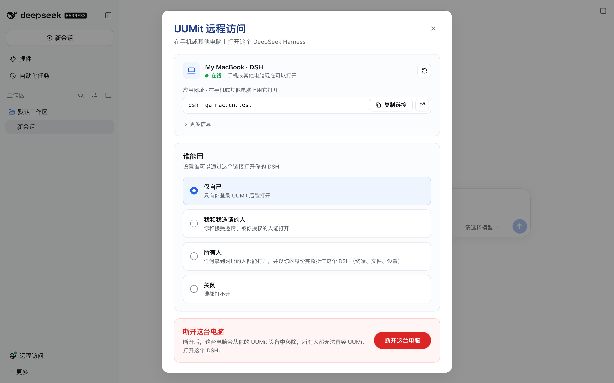

# @uumit-ai/dsh-uumit-remote

[English](README.md) | 简体中文

[DeepSeek Harness](https://www.npmjs.com/package/@deepseek-ai/dsh)（DSH）插件：不用安装 UUMit 客户端，在手机或其他电脑上，通过 [UUMit](https://uumit.com) 打开这台电脑上的 DSH。

装好插件后，点 DSH 侧栏底部设置按钮旁的「远程访问」，在 DSH 页面内弹出的面板里连接到 UUMit、选择谁能用。之后你和你邀请的人打开应用网址（形如 `https://dsh--<你的电脑>.<UUMit 地址域名>/`），看到的就是和本机一样的 DSH：对话、终端、文件、设置都可以用，设置会写回这台电脑。



插件运行在 DSH 自己的进程里，直接连 UUMit 的通道，不下载、不启动任何其他程序，也不在本机开放端口。

> **Beta**：这是预览版，以 `beta` 标签发布。1.0 之前行为和配置可能还会调整。

## 要求

- `dsh web`（DeepSeek Harness 0.2.1-rc.2 及以上）。DSH 桌面版不起 Web 服务，不支持。
- Node.js 22.19 及以上（与 DSH 相同）。
- 一个 UUMit 账号。

## 安装

```bash
dsh plugin --profile web add @uumit-ai/dsh-uumit-remote@beta
```

装好后重启 `dsh web`。

DSH 用 pnpm 安装插件，pnpm 默认会跳过最近 24 小时内发布的版本。新版本发布后一天内，`@beta` 可能还会装到上一个版本；想马上用新版，可以写明版本号，例如 `@uumit-ai/dsh-uumit-remote@0.1.0-beta.3`。

使用 npmmirror 等镜像源时，如果提示找不到这个版本，说明镜像还没同步到新版本，可以直连官方源安装：

```bash
dsh plugin --profile web add @uumit-ai/dsh-uumit-remote@beta --registry=https://registry.npmjs.org/
```

卸载：

```bash
dsh plugin --profile web remove @uumit-ai/dsh-uumit-remote
```

插件是纯 JavaScript，没有运行时依赖，也不需要构建。浏览器端 `client.js` 直接写成 DSH 加载器要求的工厂格式，React 由 DSH 页面提供。

## 使用

1. 在本机打开 DSH，点侧栏底部设置按钮旁的「远程访问」（侧栏收起时是一个地球图标），管理面板会在 DSH 页面内弹出，不会另开窗口。入口没有出现时，可以打开 `<dsh web 地址>/uumit-remote/` 兜底页。
2. 点「连接到 UUMit」，在打开的网页里登录 UUMit，核对网页上的连接码与面板里一致后确认。打不开确认页时，可以在 UUMit 网页生成 8 位配对码填进来。
3. 连接后 DSH 会作为应用 `dsh` 出现在你的 UUMit 地址里，在「谁能用」里选择：
   - **仅自己**：只有你登录 UUMit 后能打开；
   - **我和我邀请的人**：可以生成邀请链接，或按手机号直接授权，随时撤销；
   - **所有人**：任何拿到网址的人都能以你的身份完整操作这个 DSH，面板会二次确认；
   - **关闭**。
4. 在任何地方打开面板里的「应用网址」即可使用。
5. 不用了可以点「断开这台电脑」，这台电脑会从你的 UUMit 设备中移除。

也可以让 DSH 里的 Agent 帮忙：插件注册了工具 `uumit_remote_access`（查看状态、发起连接、告诉你在哪里管理）。Agent 不能替你改「谁能用」。

## 配置

在 profile 的 `cordis.patch.yml` 里按 `id: uumit-remote` 覆盖（整条替换，没写的项回到默认）。

| 项 | 默认 | 说明 |
| --- | --- | --- |
| `apiBase` | `https://api.uumit.com` | 平台入口；环境变量 `UUMIT_API_BASE` 优先。非 https 只允许本机与内网地址 |
| `serviceName` | `dsh` | 登记的应用名 |
| `deviceName` | `主机名 · DSH` | 在 UUMit 上显示的电脑名；环境变量 `UUMIT_DEVICE_NAME` 也可以设置 |
| `autoConnect` | `true` | 已连接的电脑在 DSH 启动时自动上线；未连接时不会自动发起连接 |
| `home` | `$DSH_HOME/uumit-remote` | 本地状态目录 |

测试环境开关（只用于联调）：`UUMIT_TUNNEL_INSECURE_TLS=1` 不校验通道节点证书，`UUMIT_TUNNEL_CA_FILE` 指定节点 CA，`UUMIT_WEB_BASE` 指定网页入口。

## 安全

- 访问控制以 UUMit 网关的判定为准；插件再按同样的规则核对每个请求，缺失或异常一律拒绝。
- 远程浏览器拿不到 DSH 的登录凭据；插件在本机兑换一个只留在内存里的内部凭据，附在转发给 DSH 的请求上。撤销某个人后，他的下一次请求就会被拒绝。
- 管理面板只接受这台电脑上、已打开 DSH 的浏览器；经 UUMit 打开的远程页面访问不到它。
- 设备凭证保存在 `$DSH_HOME/uumit-remote/credentials.json`（仅本人可读写），日志与页面不会出现它。
- 远程访问者选目录时使用网页内浏览，不会在你的屏幕上弹出系统对话框；「在本机打开文件或应用」类功能对远程访问者隐藏。
- 「所有人」意味着匿名访问者能以你的身份使用终端与文件，只在清楚风险时选择。

安全问题请通过 GitHub 的 [安全通报](https://github.com/uumit-ai/dsh-uumit-remote/security/advisories/new) 私下报告，不要发公开 issue。

## 开发

```bash
npm test            # 单元与集成测试
npm run test:frps   # 对真 frps 0.71.0 的协议一致性用例
```

`test:frps` 需要 frps 0.71.0 可执行文件，用 `FRPS_BIN` 指定，或放在 `test/e2e/.tools/frps`；找不到时这些用例会跳过。

本机全链路联调（用临时 `DSH_HOME`，不影响你自己的 `~/.dsh`，也不连任何共享环境）：

```bash
# 1. 真 frps + 替身平台
QA_API_PORT=18990 node test/e2e/qa-stack.mjs > /tmp/qa-stack.log
# 2. 把插件装进临时 profile 并启动 dsh web
DSH_HOME=/tmp/dsh-qa dsh plugin --profile web add link:$(pwd)
DSH_HOME=/tmp/dsh-qa UUMIT_API_BASE=http://127.0.0.1:18990 UUMIT_TUNNEL_INSECURE_TLS=1 dsh web --host 127.0.0.1 --port 3191 --no-open > /tmp/dsh-qa-web.log
# 3. 九步验收：连接、经通道打开真 DSH、拦截、谁能用、邀请与授权、所有人确认、关闭、断开与配对码重连
node test/e2e/qa-flow.mjs /tmp/dsh-qa-web.log /tmp/qa-stack.log
```

目录：`client.js` 浏览器端（侧栏入口、页面内弹窗与管理面板），`src/frp/` frp 客户端子集，`src/control/` 平台接口与本地状态，`src/tunnel.js` 通道管理，`src/agent.js` 编排，`src/proxy/` 回环代理与身份门，`src/ui/` 本机管理接口与兜底页，`src/tool.js` Agent 工具。

## 许可证

[MIT](LICENSE)，另见 [NOTICE](NOTICE)。
